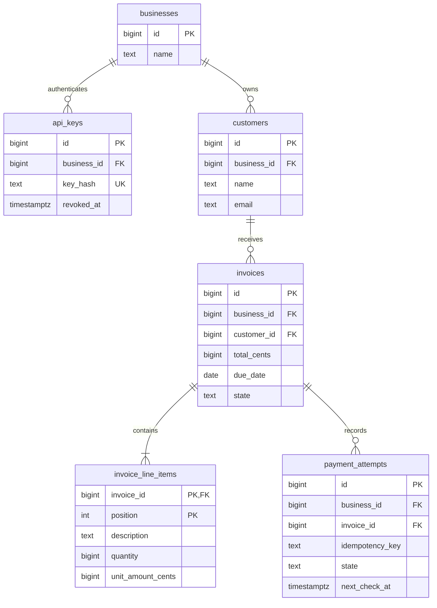
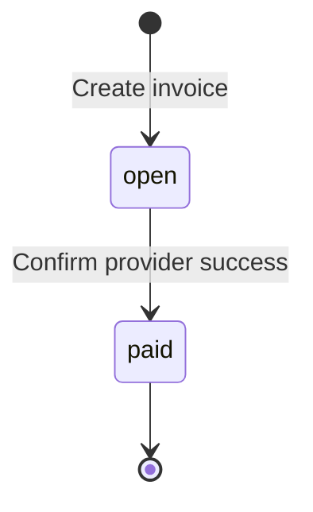
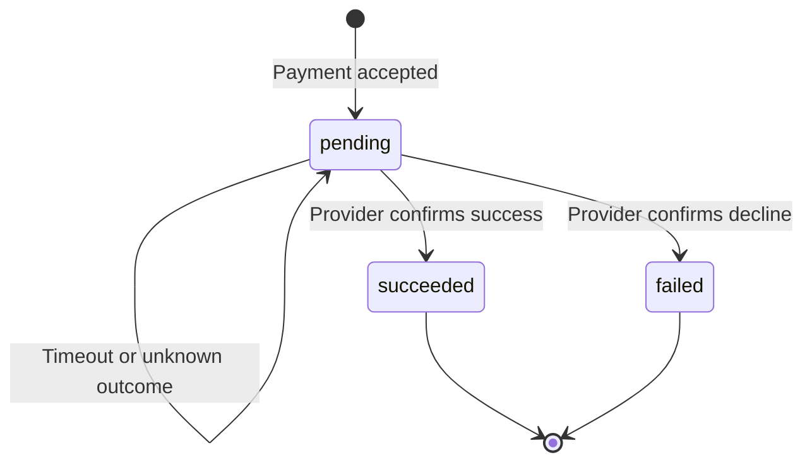

# Design

The service separates payment acceptance, provider execution, and webhook
delivery. PostgreSQL stores both domain state and pending work. A separate mock
provider, accessed over HTTP, models delayed responses and uncertain outcomes.

## 1. Data Model

| Table | Purpose |
| --- | --- |
| businesses | Business identity and name. |
| api_keys | Business, unique key hash, prefix, creation/revocation timestamps. |
| customers | Business, name, email, creation timestamp. |
| invoices | Business/customer, due date, total cents, state and timestamps. |
| invoice_line_items | Invoice, position, description, quantity, unit cents. |
| payment_attempts | Request identity, result, original acceptance and recovery schedule. |
| webhook_endpoints | One fixed URL and retrievable signing secret per business. |
| webhook_events | Exact event payload, captured endpoint, delivery count/schedule/result. |
| Provider provider_operations | Attempt identity, original input, stable UUID, outcome and readiness. |
| Provider demo_webhook_receipts | Event ID primary key, exact payload and receipt time for durable demo deduplication. |

Core billing relationships and selected columns:

Application primary keys are `bigint` identities. Line items use
`(invoice_id, position)`. Provider operations use the application attempt ID as
their primary key and a UUID provider reference. Queries derive business scope
from the authenticated key. Composite foreign keys also prevent cross-business
customer, invoice, and endpoint references.

Money is integer USD cents, PostgreSQL `bigint` and Rust `i64`. Checked multiplication
and addition reject overflow. Quantities and totals must be positive; unit prices
may be zero. The server writes a computed invoice, its nonempty line items, and
created event in one transaction. A row CHECK cannot validate a sum across other
rows; total consistency and financial immutability belong to application writes.

Unique indexes enforce API-key hashes, business/idempotency-key pairs, and at most
one pending or successful attempt per invoice; failed history remains. Business
indexes support customer/invoice lists and state filtering; partial due-time
indexes support workers. Payload TEXT preserves exact webhook and replay bytes.
One fixed endpoint lets each event hold its delivery metadata without a separate
deliveries table. Provider references and receipt IDs are unique.

The provider owns separate database credentials and migrations on the same
PostgreSQL instance. Each role is denied `CONNECT` to the other database. The
application accesses provider operations only over HTTP. This preserves the
service boundary while keeping deployment to three containers; both services
share the database instance's availability.

At 100x, I would assess queue age, query plans, and database load.
Bounded worker concurrency and atomic claims with
expiring leases would enable multiple instances. If idle queries or discovery
latency matter, add `LISTEN`/`NOTIFY` wakeups while retaining
startup/reconnect scans and retry timers. Notifications do not claim work.
API and worker capacity can scale separately.

## 2. Invoice State Machine

### Invoice

### Payment attempt

Paid invoices and succeeded/failed attempts are terminal; transitions are irreversible.
A decline leaves the invoice open and permits a new attempt. Unknown outcomes stay
pending and block new attempts. Guarded transactions and database constraints
enforce transitions. Invalid new payment requests return `409`; no arbitrary
state-update API exists.

## 3. Payment Correctness & Failure Modes

### Simultaneous payments and concurrency

The handler authenticates, validates, and checks the business/idempotency key.
New work uses a READ COMMITTED transaction that locks the tenant's invoice row,
repeats the key lookup, checks eligibility, and inserts the attempt, exact accepted
response, and immediate schedule. It commits before returning `202`; provider HTTP calls run
outside the transaction. Different keys competing for one invoice admit one
attempt; the others receive `409`. Matching keys replay the same response.
The row lock serializes admission, backed by a partial unique index. A same-key
race across different invoices hits a unique constraint; the handler rolls back
and reads the winning record.

Row locks express the resource being protected. An application mutex would not
coordinate processes; serializable isolation requires broader retry handling.
The deployment has one application instance and two independent sequential
workers, allowing concurrent HTTP requests without distributed work ownership.

Idle payment/webhook workers poll every 500 ms/one second. Due-work queries
discover new jobs, scheduled retries, and unfinished work after restarts. This
deliberately avoids listener connection/reconnect handling, accepting empty
queries and discovery delay. PostgreSQL [LISTEN/NOTIFY](https://www.postgresql.org/docs/18/sql-notify.html)
could reduce these costs; persisted rows remain authoritative because
disconnected workers can miss notifications.

### PSP timeout

Acceptance returns `202` independently of provider latency. This gives callers
one completion path and avoids coordinating synchronous responses with background
recovery, at the cost of a lookup or webhook even for fast payments. The worker
uses a two-second HTTP timeout and reschedules unresolved attempts five seconds later.
Lookup comes first; absence permits submission with the same attempt identity.
Timeouts, transport failures, and malformed responses remain pending. Clients
query the attempt or receive its eventual webhook. Only a confirmed provider
result changes payment state.

### Crash after PSP success

The provider commits request identity, outcome, UUID, and readiness before delay
or response. Restarted application workers retrieve that operation instead of
creating another identity. Duplicate submissions compare invoice, amount, and
token. Stored readiness also survives provider restart or request cancellation.

Finalization locks invoice then attempt, checks pending state, and commits attempt
result, invoice state, and event together. Repeated results are no-ops. The
network-error token records success but returns 500; lookup resolves the actual
outcome without another charge. Recovery depends on eventual provider availability.

### Reused keys and already-paid invoices

Different invoice/token input with the same key returns 409. Matching retries
return stored 202 body bytes and the same attempt location, even after settlement.
The replay check precedes paid-invoice rejection. A new key on a paid invoice
returns `409`. Idempotency keys and attempt history are retained indefinitely.

## 4. Webhook Design

Domain transactions insert `invoice.created`, `invoice.paid`, and
`invoice.payment_failed` events. A separate worker sends committed events, keeping
receiver latency and outages outside the API response path. Events capture the
fixed endpoint at creation. Without an endpoint, they remain unscheduled;
registration affects future events only.

HMAC-SHA256 signs the decimal Unix timestamp, a period, and exact body bytes.
Headers are `Webhook-Timestamp` and `Webhook-Signature: v1=<hex>`. Receivers verify
before parsing, compare signatures in constant time, allow 300 seconds of clock
difference, and durably deduplicate the signed event ID together with accepted
work. Retries preserve ID/body but refresh signatures. Ordering is not guaranteed;
current invoice/payment state is authoritative.

Five total attempts use exponential waits of 5, 10, 20, and 40 seconds after the
initial attempt. Each request times out after five seconds, bounded by a 15-minute
lifetime from creation including queueing/downtime. The worker persists dispatch
count and recovery schedule before HTTP. Crashes cannot reset the budget or allow
a sixth dispatch. Reservation records a fallback time covering the HTTP timeout and next
backoff; a failed request then schedules from its completion. A fifth reservation
recovers to exhaustion if its acknowledgment was not persisted. Any 2xx
acknowledges; other outcomes retry. Redirects and automatic transport retries are
disabled. URLs must be operator-allowlisted and HTTPS except for the explicitly
configured internal demo.

Exhausted events remain stored. Exhaustion means acknowledgment was not confirmed;
a receiver may have accepted a request whose response was lost. Businesses
reconcile via invoice reads and attempt history. Event history and manual
redelivery APIs are omitted. The demo receiver verifies signatures and persists
receipt IDs before acknowledging, including duplicates.

## 5. API Key Model

API keys contain 32 cryptographically random bytes, hex encoded and revealed once.
Storage contains a SHA-256 hash, eight-character prefix, and metadata. High-entropy
generated keys do not need password stretching. Clients send
`Authorization: Bearer <key>` over HTTPS in deployment;
local Compose uses HTTP. Each request checks revocation and derives business scope
from the key. A leaked key exposes that business's API capabilities. Revocation
does not cancel requests already authenticated.

An operator CLI creates businesses and keys, lists metadata, and revokes keys using
database credentials. Rotation permits overlapping keys while clients migrate,
followed by revocation of the old key. Demo credentials are for development.
Bootstrap checks existing hashes, including revoked rows, and creates
the business, key, and endpoint together only when absent. Webhook secrets must
remain retrievable, unlike API-key hashes.

## 6. What We Cut and Why

1. Horizontal scaling: I wanted the service to run across multiple application
   instances. I deferred this to keep the work within the assignment's 4–6 hour
   budget and focus on payment correctness. Safe replicas need durable claims
   with expiring leases and bounded worker concurrency. The current instance
   supports concurrent HTTP requests with sequential workers.
2. Draft/edit/void flows: immutable open-to-paid invoices keep transitions small;
   refunds and partial payments are explicitly outside the assignment.
3. Multiple destinations and replay APIs: a fixed endpoint and state reconciliation
   meet this version's needs.
4. A queue broker and public administration API: PostgreSQL persists work and the
   operator CLI handles provisioning.

## 7. Production Readiness Gap

1. Operational visibility: alert on pending payment age, queue backlog, provider
   failures, and exhausted deliveries; add traceable metrics.
2. Availability/recovery: exercise backup restoration, remove the shared database
   failure point, and coordinate workers before horizontal scaling.
3. Internet deployment: managed TLS/secrets, encryption for retrievable signing
   keys, and production rate limiting. Broader endpoint registration requires
   appropriate outbound-network controls.
