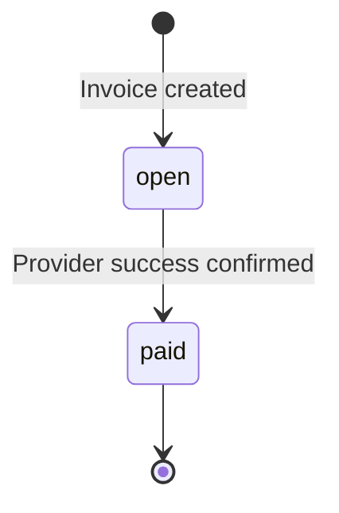

# Design

<!-- Target roughly 800 to 1,500 words. Describe actual implementation choices and limitations. -->

Status: SQL migrations implement the data model. The behavior described below
records agreed design decisions; HTTP handlers, workers, provider recovery, and
the administration CLI are not implemented yet. Retry policy and API details
remain to be designed.

## 1. Data Model

<!-- Add an ER diagram or table listing. For each table: shape, indexes, primary key strategy, why this shape over alternatives, and changes at 100x scale. Cover businesses, customers, invoices, line items, payment attempts, and supporting tables actually used. Explain integer USD cents and server-computed totals. -->

Application records use `bigint` identity primary keys. IDs are identifiers, not
authorization: every request must derive its business from its API key and scope
its queries accordingly. Composite foreign keys additionally prevent an invoice
from referencing another business's customer or an attempt from referencing
another business's invoice.

| Table | Purpose |
| --- | --- |
| `businesses` | Business identity and name. |
| `api_keys` | Business-scoped key hash, display prefix, creation and revocation timestamps; no raw API key. |
| `customers` | Business-scoped customer name and email. |
| `invoices` | Customer, due date, `total_cents`, `open`/`paid` state and timestamps. |
| `invoice_line_items` | Ordered descriptions, quantities, and `unit_amount_cents`; primary key `(invoice_id, position)`. |
| `payment_attempts` | Request identity, idempotency key, pending/final result, original accepted response, and recovery scheduling. |
| `webhook_endpoints` | One fixed destination and retrievable signing secret per business. |
| `webhook_events` | Event payload and delivery state for its captured destination. |

Money is USD in integer cents, represented by PostgreSQL `bigint` and eventually
Rust `i64`. An invoice supports multiple line items, including the single-item
case. The server will compute `sum(quantity * unit_amount_cents)` using checked
integer arithmetic and insert the invoice and its items in one transaction.
Clients do not choose the total. A row-level `CHECK` cannot verify that total
against other rows; that invariant and immutable invoice contents belong to the
application write path. The schema requires positive invoice totals and
quantities, permits zero-priced items, and rejects an individual line total
exceeding the `i64` ceiling.

Payment idempotency keys are unique within a business. A partial unique index
permits at most one `pending` or `succeeded` attempt per invoice while retaining
failed attempts. These database constraints back up, but do not replace, the
payment admission transaction and provider idempotency still to be implemented.
Business-leading indexes support customer and invoice listing, with a dedicated
invoice state-filter index. Partial due-time indexes support pending payment and
webhook scans. API-key hashes and provider references have unique indexes.

Webhook payloads are stored as serialized JSON text so retries can send exactly
the same bytes. An event captures its destination when created; without an
endpoint it remains recorded but is not scheduled. Later registration applies
only to future events. A single endpoint lets one table hold both event and
delivery metadata; supporting multiple destinations would require separate
delivery records. API keys can be hashed, whereas webhook secrets must remain
available to the sender for signing.

The mock provider will own an independent database on the same PostgreSQL
instance, with its own migration directory and operation records keyed by the
application attempt ID. It retains request identity, a stable UUID provider
reference, planned outcome, and readiness time. There is no cross-database
foreign key: the application communicates with the provider over HTTP. Separate
databases model ownership, not independent availability.

The learning migration was removed at the author's direction; the assignment
schema is now the initial application migration. Use a fresh assignment database
if an existing database has already applied the learning migration. The provider
migration must be applied to its own database.
At 100x volume, measure query plans and worker backlog first, then revisit
delivery concurrency, retention, and indexes for observed access patterns.

## 2. Invoice State Machine

<!-- Add an ASCII, Mermaid, or image diagram showing every state, valid transition, trigger, and terminal state. -->

Invoices start `open`; `paid` is terminal. A declined attempt leaves its invoice
`open`. Attempts move from `pending` to `succeeded` or `failed`. A timeout is not
a confirmed decline, so an unresolved attempt stays `pending` and blocks a new
attempt. SQL constrains allowed state values and row consistency; application
transactions will enforce transitions.

### Reversible Transitions

None. A confirmed failed attempt permits a new attempt on the still-open invoice.
Drafts, editing, voiding, refunds, and partial payments are outside this version.

### Invalid Transition Rejection

## 3. Payment Correctness & Failure Modes

### (a) Simultaneous Payments for the Same Invoice

<!-- Outcome and mechanism guaranteeing it. -->

### (b) PSP Timeout

<!-- tok_timeout takes 30 seconds: endpoint response, invoice/payment attempt states, and how the caller learns the eventual result. -->

### (c) Crash After PSP Success Before Persistence

<!-- Retry behavior, double-charge prevention, and any unresolved limitations. -->

### (d) Idempotency Key Reused With a Different Body

### (e) Payment Requested for an Already Paid Invoice

### Concurrency Mechanism and Alternatives

<!-- Name the mechanism used and explain why it was chosen over alternatives. Describe idempotency scope and persistence. -->

## 4. Webhook Design

### Events and Asynchronous Delivery

<!-- invoice.created, invoice.paid, invoice.payment_failed; why and how delivery is decoupled from API responses. -->

### Signing and Replay Protection

<!-- Algorithm, signed content, verification, and replay protection. -->

### Retry Policy

<!-- Specific intervals, maximum attempts, and total retry budget. -->

### Exhausted Retries and Missed-Event Reconciliation

## 5. API Key Model

<!-- Generation, storage (plaintext/hash/prefix), transmission, business scoping, rotation, revocation, and blast radius if leaked. -->

Agreed implementation plan: generate 32 cryptographically random bytes, reveal
the API key once, and store a SHA-256 hash with display metadata. Clients send
`Authorization: Bearer <key>`. Authentication will check revocation in the
database on each request. A leaked key exposes its business's API capabilities;
tenant-scoped queries limit its reach. Revocation cannot cancel requests already
authenticated.

A small operator CLI will create businesses, create and list keys, and revoke
keys using database credentials. Rotation creates a replacement key, allows an
overlap while clients switch, then revokes the old key. Automatic demo
bootstrapping remains planned, without a public signup or administrative HTTP API.

## 6. What You Cut and Why

<!-- List 3 to 5 deliberate omissions with reasons, including at least one thing you wanted to build. -->

1. <!-- Omission and reason. -->
2. <!-- Omission and reason. -->
3. <!-- Omission and reason. -->

## 7. Production Readiness Gap

<!-- Top 3 things missing if shipped tomorrow; explain priority. Discuss production rate limiting here. Mention refunds or partial payments if you would add them later. -->

1. <!-- Gap and priority. -->
2. <!-- Gap and priority. -->
3. <!-- Gap and priority. -->
