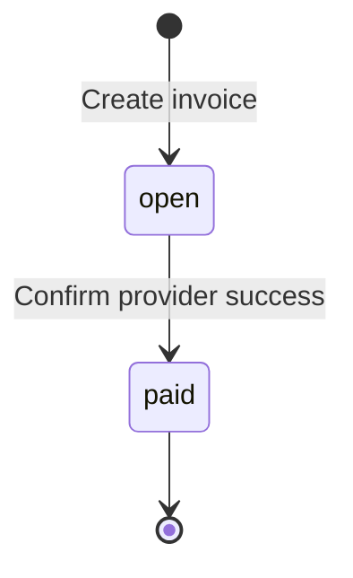

# Design

Implementation checkpoint: schemas, API-key administration/authentication, health,
and their tests are implemented. The remaining behavior below is the agreed
contract, to be verified as each feature lands.

## 1. Data Model

| Table | Purpose |
| --- | --- |
| businesses | Business identity and name. |
| api_keys | Business, unique key hash, prefix, creation/revocation timestamps. |
| customers | Business, name, email, creation timestamp. |
| invoices | Business/customer, due date, total cents, state and timestamps. |
| invoice_line_items | Invoice, position, description, quantity, unit cents. |
| payment_attempts | Request identity, result, original acceptance and recovery schedule. |
| webhook_endpoints | One fixed URL and retrievable signing secret per business. |
| webhook_events | Exact event payload, captured endpoint, delivery count/schedule/result. |
| Provider provider_operations | Attempt identity, original input, stable UUID, outcome and readiness. |

Application primary keys are bigint identities. Line items use (invoice_id,
position). Provider operations use the application attempt ID as their primary
key and a UUID provider reference. Numeric IDs are not authorization: queries
must use authenticated business scope. Composite foreign keys also prevent
cross-business customer, invoice, and endpoint references.

Money is integer USD cents, PostgreSQL bigint and Rust i64. Checked multiplication
and addition reject overflow. Quantities and totals must be positive; unit prices
may be zero. The server writes a computed invoice, its nonempty line items, and
created event in one transaction. A row CHECK cannot validate a sum across other
rows; total consistency and financial immutability belong to application writes.

Unique indexes enforce API-key hashes, business/idempotency-key pairs, and at most
one pending or successful attempt per invoice; failed history remains. Business
indexes support customer/invoice lists and state filtering; partial due-time
indexes support workers. Payload TEXT preserves exact webhook and replay bytes.
One endpoint lets an event hold delivery metadata without another deliveries table.

The provider owns separate database credentials and migrations on the same
PostgreSQL instance. Application code only accesses it over HTTP. Separate
databases model ownership, not independent availability. Use a fresh assignment
database if the removed learning migration was previously applied. Never rewrite
committed migrations to introduce later features.

At 100x, measure queue age, query plans, and database load. Add bounded worker
concurrency and atomic claims with expiring leases before running multiple
instances. Scale API and workers separately if useful, then address retention
and indexes based on actual access patterns.

## 2. Invoice State Machine

Invoices start open; paid is terminal. There are no reversible transitions.
Attempts move pending to succeeded or failed. Confirmed declines leave invoices
open and permit new attempts. Timeouts stay pending and block fresh attempts.
Guarded transactions enforce transitions, backed by row constraints. Invalid new
payment requests return explicit 409 conflicts; no arbitrary state-update API exists.

## 3. Payment Correctness & Failure Modes

### Simultaneous payments and concurrency

Authenticate and validate, then look for an existing business/key. New work uses a
READ COMMITTED transaction that locks the tenant's invoice row, repeats the key
lookup, checks eligibility, and inserts the attempt, exact accepted response, and
immediate schedule. Commit before returning 202. Never hold the transaction across
HTTP. Competing requests for the same invoice serialize; the partial unique index
backs this up. A same-key race across different invoices hits a unique constraint:
roll back and inspect the winning record.

Row locks express the resource being protected. An application mutex would not
coordinate processes; serializable isolation requires broader retry handling.
The initial deployment has one application instance and two independent sequential
workers, allowing concurrent HTTP requests without distributed work ownership.

### PSP timeout

Acceptance always returns 202 independently of provider latency. The worker uses
a two-second HTTP timeout and reschedules unresolved attempts five seconds later.
Lookup comes first; absence permits submission with the same attempt identity.
Timeouts, transport failures, and malformed responses remain pending. Clients
query the attempt or receive its eventual webhook. A timer never proves decline.

### Crash after PSP success

The provider commits request identity, outcome, UUID, and readiness before delay
or response. Restarted application workers retrieve that operation instead of
creating another identity. Duplicate submissions compare invoice, amount, and
token. Stored readiness also survives provider restart or request cancellation.

Finalization locks invoice then attempt, checks pending state, and commits attempt
result, invoice state, and event together. Repeated results are no-ops. The
network-error token records success but returns 500; lookup resolves the actual
outcome without another charge. Recovery depends on eventual provider availability.

### Reused keys and already-paid invoices

Different invoice/token input with the same key returns 409. Matching retries
return stored 202 body bytes and the same attempt location, even after settlement.
Check replay before rejecting paid invoices. A new key on a paid invoice returns
409. Retain keys and attempt history for this version.

## 4. Webhook Design

Domain transactions insert invoice.created, invoice.paid, and
invoice.payment_failed events. A separate worker sends committed events; delivery
cannot delay API responses or undo payment results. Capture the fixed endpoint at
creation. Without an endpoint, retain the event unscheduled; registration affects
future events only.

Sign decimal Unix timestamp, a period, and exact body bytes with HMAC-SHA256.
Headers are Webhook-Timestamp and Webhook-Signature: v1=<hex>. Receivers verify
before parsing, compare signatures in constant time, allow 300 seconds of clock
difference, and durably deduplicate the signed event ID together with accepted
work. Retries preserve ID/body but refresh signatures. Ordering is not guaranteed;
current invoice/payment state is authoritative.

Five total attempts use exponential waits of 5, 10, 20, and 40 seconds after the
initial attempt. Each request times out after five seconds, bounded by a 15-minute
lifetime from creation including queueing/downtime. Persist dispatch count and
recovery schedule before HTTP. Crashes cannot reset the budget or allow a sixth
dispatch. Any 2xx acknowledges; other outcomes retry. Disable redirects. URLs must
be operator-allowlisted and HTTPS except for the explicitly configured internal demo.

Retain exhausted events. Exhaustion means acknowledgment was not confirmed; a
receiver may have accepted a request whose response was lost. Businesses reconcile
via invoice reads and attempt history. Event history and manual redelivery APIs
are omitted. The demo receiver verifies signatures and persists receipt IDs
before acknowledging, including duplicates.

## 5. API Key Model

Generate 32 cryptographically random bytes, hex encode, and reveal once. Store
SHA-256 hash, prefix, and metadata. High-entropy generated keys do not need password
stretching. Clients send Authorization: Bearer <key> over HTTPS in deployment;
local Compose uses HTTP. Each request checks revocation and derives business scope
from the key. A leaked key exposes that business's API capabilities. Revocation
does not cancel requests already authenticated.

An operator CLI creates businesses and keys, lists metadata, and revokes keys using
database credentials. Rotate by adding a key, moving clients, and revoking the old
one. Demo credentials are explicitly for development; bootstrap must not resurrect
revoked keys. Webhook secrets must remain retrievable, unlike API-key hashes.

## 6. What We Cut and Why

1. Multiple app instances/parallel workers: single-instance deployment avoids job
   ownership coordination while preserving concurrent HTTP correctness.
2. Draft/edit/void flows: immutable open-to-paid invoices keep transitions small;
   refunds and partial payments are explicitly outside the assignment.
3. Multiple destinations and replay APIs: a fixed endpoint and state reconciliation
   meet this version's needs.
4. A queue broker and public administration API: PostgreSQL persists work and the
   operator CLI handles provisioning.

Before submission, the author must identify a deferred capability they personally
wanted to build. That personal reflection must not be invented.

## 7. Production Readiness Gap

1. Operational visibility: alert on pending payment age, queue backlog, provider
   failures, and exhausted deliveries; add traceable metrics.
2. Availability/recovery: exercise backup restoration, remove the shared database
   failure point, and coordinate workers before horizontal scaling.
3. Internet deployment: managed TLS/secrets, encryption for retrievable signing
   keys, and production rate limiting. Broader endpoint registration requires
   appropriate outbound-network controls.
