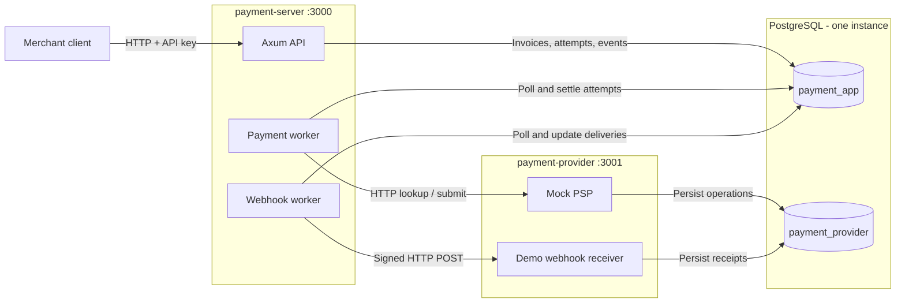

# Invoice & Payment Service

A Rust service using Axum, SQLx, and PostgreSQL. It creates immutable USD invoices,
accepts payments asynchronously, recovers uncertain outcomes through a separate
mock payment provider, and delivers signed webhooks with durable retry budgets.

## Demo Video

[Watch the demo on Loom](https://www.loom.com/share/10fdef642dec4c5eb29c5d65dfbdb233).

## Architecture



This shows the three-service Compose deployment. Both workers poll durable work
in the application database. The demo receiver shares the provider process;
other businesses can register an allowlisted external endpoint.

[Table relationships](DESIGN.md#1-data-model) ·
[Payment data flow](API.md#payment-data-flow) ·
[Webhook delivery](API.md#webhook-delivery) ·
[Invoice states](DESIGN.md#2-invoice-state-machine)

## Running the Service

With Docker and its Compose plugin installed:

```sh
docker compose up
```

This builds both binaries, initializes PostgreSQL with separate application and
provider databases/credentials, applies migrations, and creates a demo business,
API key, and webhook endpoint. No manual database or business setup is required.
The first build needs network access to download images and Rust dependencies.

The application is at `http://127.0.0.1:3000`. Only its port is published, on the
loopback interface. The provider (`payment-provider:3001`) and PostgreSQL remain
inside the Compose network. `GET /health` checks database connectivity. Follow
verified webhook receipts with:

```sh
docker compose logs -f payment-provider
```

The local development API key is:

```sh
export API_KEY=1111111111111111111111111111111111111111111111111111111111111111
export BASE_URL=http://127.0.0.1:3000
```

All fixed credentials in `docker-compose.yml` are **development-only**. The demo
signing secret is 64 `2` characters; the demo endpoint is already registered.
Bootstrap is transactional and checks existing key hashes, including revoked
keys. Restarting neither duplicates the business nor reactivates a revoked key.
A changed URL/secret for the existing demo identity causes a startup error.

Use `docker compose down` to stop while keeping the named database volume.
Rebuild after source changes with `docker compose up --build`. If port 3000 is
occupied, use `APP_PORT=3002 docker compose up` and update `BASE_URL` accordingly.

Podman users can replace `docker compose` with `podman compose`.

## Curl Examples

These four examples use `curl` and `jq` and capture returned IDs, so they also work
with an existing database. Run them in the same shell after setting the variables
above. The two payment cases use different invoices.

### 1. Create a Customer

```sh
CUSTOMER=$(curl -fsS "$BASE_URL/customers" \
  -H "Authorization: Bearer $API_KEY" -H 'Content-Type: application/json' \
  -d '{"name":"Ada","email":"ada@example.com"}')
printf '%s\n' "$CUSTOMER"
CUSTOMER_ID=$(printf '%s' "$CUSTOMER" | jq -r '.id')
```

Returns `201`, for example `{"id":1,"business_id":1,"name":"Ada",...}`.

### 2. Create an Invoice

```sh
INVOICE=$(curl -fsS "$BASE_URL/invoices" \
  -H "Authorization: Bearer $API_KEY" -H 'Content-Type: application/json' \
  -d "{\"customer_id\":$CUSTOMER_ID,\"due_date\":\"2026-10-31\",\"line_items\":[{\"description\":\"Notebook\",\"quantity\":2,\"unit_amount_cents\":1000}]}")
printf '%s\n' "$INVOICE"
INVOICE_ID=$(printf '%s' "$INVOICE" | jq -r '.id')
```

Returns `201` with `state: "open"`, `total_cents: 2000`, and ordered line items.
The server computes the total; supplied totals are rejected.

### 3. Attempt a Successful Payment

```sh
ACCEPTED=$(curl -fsS "$BASE_URL/invoices/$INVOICE_ID/pay" \
  -H "Authorization: Bearer $API_KEY" -H 'Content-Type: application/json' \
  -H "Idempotency-Key: demo-success-$INVOICE_ID" -d '{"card_token":"tok_success"}')
printf '%s\n' "$ACCEPTED"
ATTEMPT_ID=$(printf '%s' "$ACCEPTED" | jq -r '.payment_attempt_id')
curl -fsS "$BASE_URL/payment-attempts/$ATTEMPT_ID" -H "Authorization: Bearer $API_KEY"
```

Acceptance returns `202 {"payment_attempt_id":1,"invoice_id":1,"status":"pending"}`
with a `Location` header. The lookup initially may be pending; repeat it to see
`succeeded` with a UUID `psp_ref`. The invoice becomes paid and an `invoice.paid`
webhook is delivered. Repeating the same payment command/key replays the original
acceptance bytes and does not call the provider again.

### 4. Attempt a Declined Payment

```sh
DECLINED_INVOICE=$(curl -fsS "$BASE_URL/invoices" \
  -H "Authorization: Bearer $API_KEY" -H 'Content-Type: application/json' \
  -d "{\"customer_id\":$CUSTOMER_ID,\"due_date\":\"2026-10-31\",\"line_items\":[{\"description\":\"Decline example\",\"quantity\":1,\"unit_amount_cents\":500}]}")
DECLINED_ID=$(printf '%s' "$DECLINED_INVOICE" | jq -r '.id')
DECLINED_ACCEPTANCE=$(curl -fsS "$BASE_URL/invoices/$DECLINED_ID/pay" \
  -H "Authorization: Bearer $API_KEY" -H 'Content-Type: application/json' \
  -H "Idempotency-Key: demo-decline-$DECLINED_ID" -d '{"card_token":"tok_card_declined"}')
printf '%s\n' "$DECLINED_ACCEPTANCE"
DECLINED_ATTEMPT=$(printf '%s' "$DECLINED_ACCEPTANCE" | jq -r '.payment_attempt_id')
curl -fsS "$BASE_URL/payment-attempts/$DECLINED_ATTEMPT" -H "Authorization: Bearer $API_KEY"
```

This also returns `202`. Repeated lookup eventually shows `status: "failed"` and
`failure_code: "card_declined"`. The invoice stays open; an
`invoice.payment_failed` webhook is delivered. A new key can start a fresh attempt
after this confirmed decline.

On a fresh invoice, `tok_timeout` resolves after roughly 30–35 seconds.
`tok_network_error` stores success behind a simulated `500` and resolves by
lookup. Both remain pending until the provider confirms the outcome.

## Administration and Native Development

The demo business has ID 1 on a fresh volume. Rotate its key by issuing another,
moving clients to the returned key, then revoking the old key. IDs below refer to
that fresh demo; inspect returned metadata when using another database.

```sh
docker compose exec -T app payment-server admin create-key 1
docker compose exec -T app payment-server admin list-keys 1
# After clients have adopted the replacement, revoke the original demo key:
docker compose exec -T app payment-server admin revoke-key 1
# Separate business provisioning:
docker compose exec -T app payment-server admin create-business "Another Business"
```

Creation reveals a key once. Listing exposes metadata only. Revoking an already
revoked key is safe. These commands use database credentials rather than a public
administration endpoint. Keep bootstrap settings fixed when rotating keys.

Native development needs Rust and two existing PostgreSQL databases. In separate
terminals, using each database owner's connection URL:

```sh
DATABASE_URL=postgresql://localhost/payment_provider cargo run --bin payment-provider
DATABASE_URL=postgresql://localhost/payment_app cargo run --bin payment-server
```

Provision a native business with:

```sh
DATABASE_URL=postgresql://localhost/payment_app cargo run -- admin create-business "Example Business"
```

Startup applies SQLx migrations automatically. Each binary runs only the
migrations for its own database.

SQL row types and worker query projections live in `src/entities`. JSON request
types live in `src/models/forms`; response envelopes and composite responses live
in `src/models/data`. Entities are returned directly when their fields match the
response. Shared protocol enums live in `src/models/enums`. `MockCardToken`
centralizes supported token parsing; request fields remain strings to preserve
idempotency conflict handling before invalid-token rejection.

| Variable | Native behavior / Compose setting |
| --- | --- |
| `DATABASE_URL` | Required for each binary; separate databases and roles in Compose. |
| `BIND_ADDR` | Defaults to `127.0.0.1:3000` for app, `127.0.0.1:3001` for provider; Compose binds inside containers on `0.0.0.0`. |
| `PSP_URL` | App default `http://127.0.0.1:3001`; Compose uses `http://payment-provider:3001`. |
| `WEBHOOK_ALLOWED_URLS` | Comma-separated exact destination URLs; empty by default. |
| `DEMO_WEBHOOK_URL` | The one explicit HTTP exception; must also be allowlisted. Compose sets the provider's `/demo/webhooks` URL. |
| `DEMO_API_KEY` | Optional development bootstrap key, 64 hex characters. |
| `DEMO_WEBHOOK_SECRET` | 64 hex characters; app bootstrap and provider receiver share this in Compose. |
| `APP_PORT` | Compose host port, default 3000; always bound to loopback. |

On the app, the three `DEMO_*` values must be present together or all absent.
The provider only reads `DEMO_WEBHOOK_SECRET`; without it, the demo receiver
returns `503`. Normal registered endpoints get random secrets. HTTPS is required
for allowlisted external destinations; redirects are disabled. Registration
applies only to future events.

## Verification

Run tests against a disposable PostgreSQL instance whose role has `CREATEDB`:

```sh
export DATABASE_URL=postgresql://localhost/postgres
cargo fmt --all -- --check
cargo check --bins --locked
cargo test --locked
cargo clippy --all-targets --locked -- -D warnings
```

SQLx creates isolated test databases. Payment tests create a separate provider
database and communicate with it over HTTP. The real timeout test takes about
33 seconds. With dependencies already cached, add `--offline` to Cargo checks.

| Checks | Evidence |
| --- | --- |
| Schema (3) | Money/state constraints, tenant foreign keys, active-attempt uniqueness, provider persistence. |
| Authentication (2) and CLI (1) | Key rotation/revocation, business scope, JSON errors, transactional provisioning. |
| Resources (1 grouped integration test) | Checked overflow, validation, pagination/filtering, line order, event capture, rollback. |
| Provider (4) | All tokens, concurrent duplicates/mismatches, cancelled request and restart persistence. |
| Payments (5) | 20 competing requests admit one charge; 20 matching requests replay one attempt; settled replay adds zero PSP calls; decline permits retry; timeout/network/crash recovery; malformed results stay pending; atomic finalization. |
| Webhooks (9) | Independent HMAC vector, invalid/stale/duplicate signatures, durable receipt deduplication, exact payload retries, exponential scheduling, redirects disabled, lifetime timeout, cancelled fifth dispatch cannot produce a sixth. |
| Bootstrap (2) | One-time seed, revoked key stays revoked, invalid/mismatched configuration fails safely. |

Formatting, compilation, strict Clippy checks, and the release container build
passed. Container acceptance used Podman on Linux arm64 with podman-compose;
Docker Engine was not tested.

A fresh Compose deployment passed all four curl examples and brought all three
services to healthy status without manual setup. Checks covered database-role
isolation, signed webhook receipts, and a full stack recreation during a pending
payment. Payments recovered without duplicate charges, bootstrap data remained
unique, and revoked keys remained invalid while replacement keys continued to work.

The core paths are [payment admission and recovery](src/payments.rs),
[provider persistence](src/provider.rs), [transactional event creation](src/events.rs),
and [webhook signing and delivery](src/webhooks.rs), with integration coverage in
[payment tests](tests/payments.rs) and [webhook tests](tests/webhooks.rs).

## Scope and Limitations

Run one application instance: payment and webhook workers are separately
sequential, while HTTP requests remain concurrent. Higher throughput needs
bounded worker concurrency; safe replicas need durable work claims/leases.
Polling deliberately keeps work discovery, scheduled retries, and restart
recovery simple. It incurs idle queries and discovery delay; `LISTEN`/`NOTIFY`
is a possible improvement if those costs matter, with recovery scans and retry
timers retained. The rationale is in [DESIGN.md](DESIGN.md#simultaneous-payments-and-concurrency).
The provider and application share one PostgreSQL instance, so availability is
shared despite separate ownership. Payment recovery depends on eventual provider
availability. Keys, attempts, events, and demo receipts have no retention policy.

There are no refunds, partial payments, draft/edit/void workflows, multiple webhook
destinations, event-history API, or manual redelivery endpoint. Five delivery
attempts use waits of 5, 10, 20, and 40 seconds within 15 minutes; exhausted events
stay stored, and businesses reconcile through invoice/attempt APIs. Production
TLS, secret management, monitoring, backups, and rate limiting remain deployment
work described in DESIGN.md.

## Documentation

- [Design](DESIGN.md)
- [API](API.md)
- [AI Usage](AI_USAGE.md)
